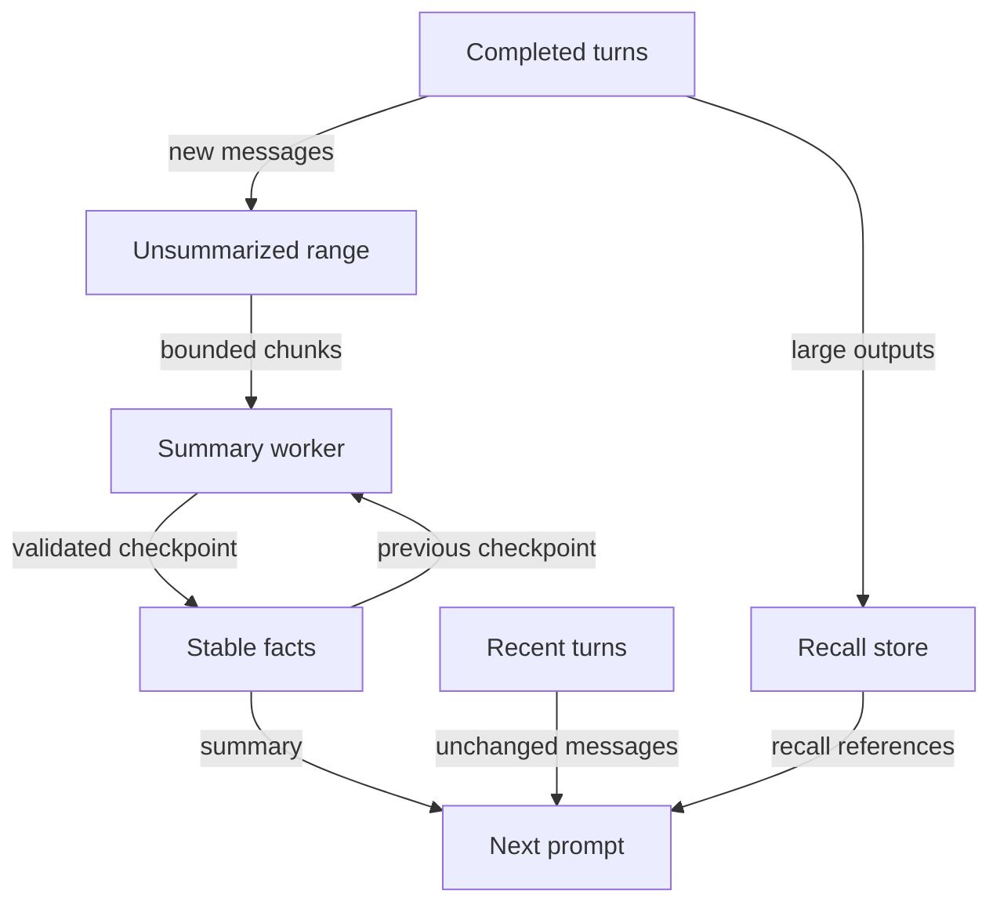

# Faster compaction — proposal for Cameron

## Solution

Keep a small summary of stable session facts. Summarize only new history since the last checkpoint.
Keep recent turns unchanged, and archive large tool outputs separately. Measure speed, cost, and retained facts before enabling this design.

**Status: proposal only. Not approved and not implemented by CHIM-88.**

CHIM-88 fixes recovery with the current synchronous compaction path. Those fixes do not depend on this proposal.
Cameron must approve the design and a separate implementation scope before work starts.

## Problem

The current summarizer reads the old conversation again at each compaction.
Repeated summary updates cost time and tokens. They can also lose earlier facts.
A larger context window postpones this cost but does not remove it.

## Proposed data flow

### Checkpoints

Store a summary and its covered event range beside the session history.
Use stable event identities and a content hash. Do not use message positions that change during compaction.
Keep goals, constraints, decisions, unfinished work, file operations, tasks, and recall references as separate fields.
Keep recent complete turns unchanged. Never split a tool call from its results.

The checkpoint records its model, prompt version, settings, and source hash.
Rewind, model changes, changed source events, and prompt changes invalidate affected checkpoints.
The event log remains the source of truth.

### Tool output

Archive large outputs once. Give each output a short description and a recall reference.
Summarize the description, not the raw output. Keep the reference outside model-generated prose.
Keep errors and recent results unchanged until the next turn completes.

### Scheduling and caching

First implement synchronous updates from a saved checkpoint. This avoids new concurrency risks.
Cache completed summaries by source hash, model reference, settings, and prompt version.
Reuse only an exact match. Resume can use a verified checkpoint without another model call.

Consider background summary work only after the synchronous design passes the quality tests.
A background worker reads a frozen range and commits only if that range still matches.
Cancel work on rewind or session deletion. Never block the next turn on a stale worker.
Retain CHIM-88's bounded recovery path if checkpoint generation fails.

### Model choice

Default to the configured utility model. Allow an explicit compaction model override.
Use that model's context window and a small output budget.
Compare model choices with the same recorded sessions before changing the default.
Do not select a model only because its first-token latency is low.

## Evaluation and acceptance

Use recorded, sanitized coding sessions with known facts and exact tool-pair boundaries.
Include repeated compactions, large outputs, images, long tool loops, model changes, resume, and rewind.
Use scripted models for fault tests. Real-model measurements require a separate operator-approved run.

Measure:

- Compaction p50 and p95 duration, and user-visible wait time.
- Input tokens, output tokens, cache reuse, and model cost per completed session.
- Recall-reference validity and exact preservation of tasks and file operations.
- Retention of goals, constraints, decisions, and unfinished work after ten compactions.
- Correct task completion, compared with the current compactor on the same sessions.
- Recovery frequency, lost-context warnings, cancellations, and checkpoint invalidations.

Proposed release gates: at least 50% lower p95 wait time and 40% fewer summary input tokens.
Require no lost authoritative state, broken tool pairs, or invalid recall references.
Require no regression in task completion or the fact-retention checks.
Cameron should approve these targets before implementation.

## Alternatives and risks

A faster model alone is simpler, but repeated history processing remains expensive.
A very short rolling summary is cheaper, but repeated compression can lose important decisions.
A larger kept tail protects recent details, but leaves less room for new work.
Parallel summaries reduce latency, but can miss dependencies between chunks.

The main risk is silent loss of facts. Keep the original history, expose checkpoint coverage,
and test summary quality separately from recovery. A fast but incorrect summary is not an improvement.

## Approval decisions

1. Approve synchronous checkpoint updates first, or include background work in the first scope?
2. Approve the proposed performance targets and the quality test corpus?
3. Choose the model candidates and the budget for a measured comparison.

No implementation is authorized by this document.
